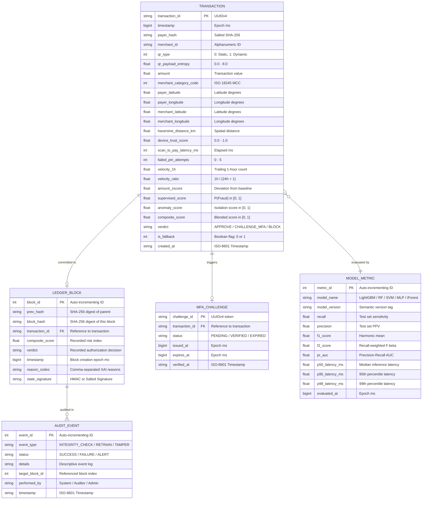

# Database Architecture & Relational Schema Design

**Project:** Advanced Quick Response (QR) Code Payment Fraud Detection System  
**Document Version:** 1.0.0  
**Status:** Approved for Baseline (Phase 05)  
**Parent Document:** `docs/05_System_Design/HIGH_LEVEL_DESIGN.md`  
**Storage Engine:** SQLite 3 (WAL Mode) via SQLAlchemy 2.0 ORM

---

## 1. Entity-Relationship Model



---

## 2. Table Schemas & DDL Definitions

### 2.1 Table: `transactions`
Stores immutable ingestion records and computed feature values for all processed payment authorizations.

```sql
CREATE TABLE IF NOT EXISTS transactions (
    transaction_id VARCHAR(36) PRIMARY KEY,
    timestamp BIGINT NOT NULL,
    payer_hash VARCHAR(64) NOT NULL,
    merchant_id VARCHAR(32) NOT NULL,
    qr_type INTEGER NOT NULL CHECK (qr_type IN (0, 1)),
    qr_payload_entropy REAL NOT NULL,
    amount REAL NOT NULL CHECK (amount > 0),
    merchant_category_code INTEGER NOT NULL,
    payer_latitude REAL NOT NULL,
    payer_longitude REAL NOT NULL,
    merchant_latitude REAL NOT NULL,
    merchant_longitude REAL NOT NULL,
    haversine_distance_km REAL NOT NULL,
    device_trust_score REAL NOT NULL CHECK (device_trust_score BETWEEN 0.0 AND 1.0),
    scan_to_pay_latency_ms INTEGER NOT NULL,
    failed_pin_attempts INTEGER NOT NULL DEFAULT 0,
    velocity_1h REAL NOT NULL,
    velocity_ratio REAL NOT NULL,
    amount_zscore REAL NOT NULL,
    supervised_score REAL NOT NULL CHECK (supervised_score BETWEEN 0.0 AND 1.0),
    anomaly_score REAL NOT NULL CHECK (anomaly_score BETWEEN 0.0 AND 1.0),
    composite_score REAL NOT NULL CHECK (composite_score BETWEEN 0.0 AND 1.0),
    verdict VARCHAR(16) NOT NULL CHECK (verdict IN ('APPROVE', 'CHALLENGE_MFA', 'BLOCK')),
    is_fallback INTEGER NOT NULL DEFAULT 0 CHECK (is_fallback IN (0, 1)),
    created_at TIMESTAMP DEFAULT CURRENT_TIMESTAMP
);

CREATE INDEX IF NOT EXISTS idx_tx_timestamp ON transactions(timestamp);
CREATE INDEX IF NOT EXISTS idx_tx_payer_hash ON transactions(payer_hash);
CREATE INDEX IF NOT EXISTS idx_tx_verdict ON transactions(verdict);
```

---

### 2.2 Table: `ledger_blocks`
Implements the cryptographic append-only audit trail linking each decision verdict to the previous block's SHA-256 hash.

```sql
CREATE TABLE IF NOT EXISTS ledger_blocks (
    block_id INTEGER PRIMARY KEY AUTOINCREMENT,
    prev_hash VARCHAR(64) NOT NULL,
    block_hash VARCHAR(64) NOT NULL UNIQUE,
    transaction_id VARCHAR(36) NOT NULL UNIQUE,
    composite_score REAL NOT NULL,
    verdict VARCHAR(16) NOT NULL,
    timestamp BIGINT NOT NULL,
    reason_codes TEXT,
    state_signature VARCHAR(64) NOT NULL,
    FOREIGN KEY (transaction_id) REFERENCES transactions(transaction_id) ON DELETE RESTRICT
);

CREATE UNIQUE INDEX IF NOT EXISTS idx_ledger_block_hash ON ledger_blocks(block_hash);
CREATE INDEX IF NOT EXISTS idx_ledger_prev_hash ON ledger_blocks(prev_hash);
```

---

### 2.3 Table: `mfa_challenges`
Tracks secondary step-up authentication tokens issued for transactions falling into the ambiguous `CHALLENGE_MFA` tier ($0.30 \le S_{\text{composite}} \le 0.70$).

```sql
CREATE TABLE IF NOT EXISTS mfa_challenges (
    challenge_id VARCHAR(36) PRIMARY KEY,
    transaction_id VARCHAR(36) NOT NULL UNIQUE,
    status VARCHAR(16) NOT NULL DEFAULT 'PENDING' CHECK (status IN ('PENDING', 'VERIFIED', 'EXPIRED', 'FAILED')),
    issued_at BIGINT NOT NULL,
    expires_at BIGINT NOT NULL,
    verified_at TIMESTAMP,
    FOREIGN KEY (transaction_id) REFERENCES transactions(transaction_id) ON DELETE CASCADE
);

CREATE INDEX IF NOT EXISTS idx_challenge_status ON mfa_challenges(status);
```

---

### 2.4 Table: `model_metrics`
Persists historical evaluation runs, benchmarking scoreboard metrics, and inference latency percentiles across algorithm iterations.

```sql
CREATE TABLE IF NOT EXISTS model_metrics (
    metric_id INTEGER PRIMARY KEY AUTOINCREMENT,
    model_name VARCHAR(32) NOT NULL,
    model_version VARCHAR(16) NOT NULL,
    recall REAL NOT NULL,
    precision REAL NOT NULL,
    f1_score REAL NOT NULL,
    f2_score REAL NOT NULL,
    pr_auc REAL NOT NULL,
    p50_latency_ms REAL NOT NULL,
    p95_latency_ms REAL NOT NULL,
    p99_latency_ms REAL NOT NULL,
    evaluated_at BIGINT NOT NULL
);

CREATE INDEX IF NOT EXISTS idx_metric_model ON model_metrics(model_name, model_version);
```

---

## 3. High-Concurrency SQLite Engine Optimization

To achieve sub-10ms database write latencies and support concurrent read queries from the Streamlit UI dashboard without contention, the SQLite connection pool enforces the following database pragmas at initialization (`backend/database/session.py`):

```python
PRAGMA journal_mode = WAL;         -- Enables Write-Ahead Logging for non-blocking concurrent reads
PRAGMA synchronous = NORMAL;        -- Safely relaxes disk sync overhead while preserving integrity
PRAGMA cache_size = -64000;         -- Allocates 64 MB in-memory buffer pool
PRAGMA foreign_keys = ON;           -- Enforces strict relational integrity
PRAGMA busy_timeout = 5000;         -- 5-second retry timeout to eliminate immediate table lock crashes
```

