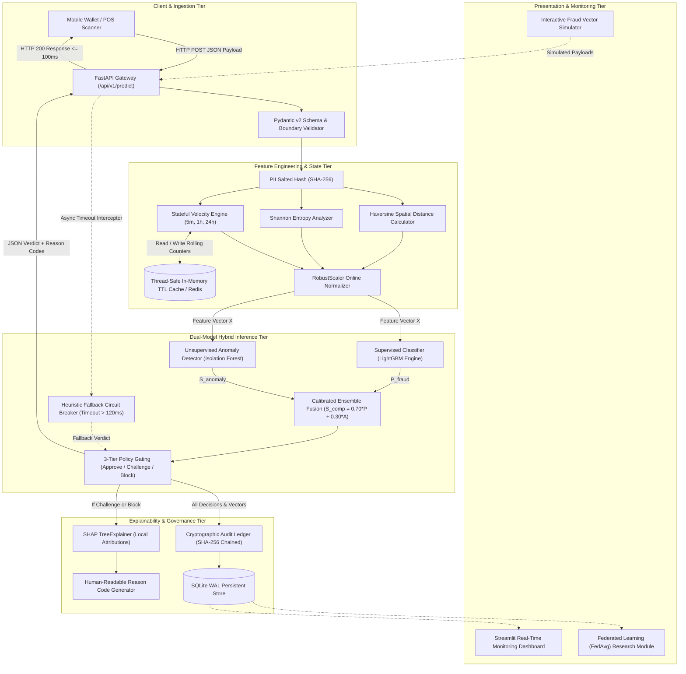
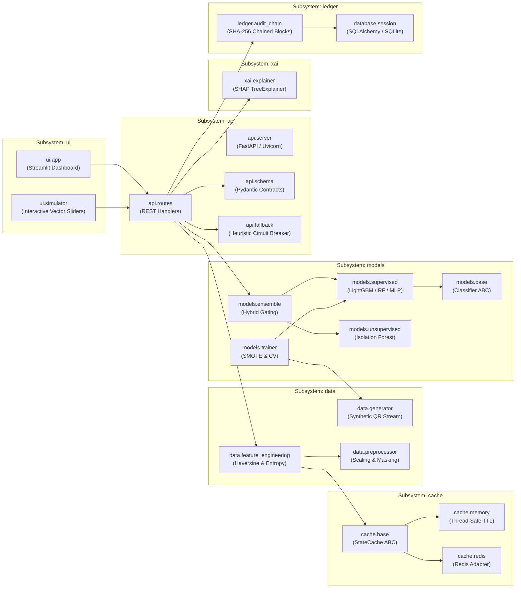

# High-Level Architecture Design (HLD)

**Project:** Advanced Quick Response (QR) Code Payment Fraud Detection System  
**Document Version:** 1.0.0  
**Status:** Approved for Baseline (Phase 05)  
**Author:** Principal Software Architect  
**Parent Document:** `docs/02_Requirements/SRS.md` | `docs/04_Technical_Research/TECHNICAL_RECOMMENDATIONS.md`

---

## 1. Architectural Paradigm & System Overview

The system implements a **High-Throughput, Low-Latency Layered Pipeline Architecture** organized into asynchronous, decoupled micro-components. The architecture is engineered to evaluate incoming payment transaction payloads in real time ($\le 100\text{ ms}$ round-trip), extract specialized spatial-temporal features, synthesize risk across supervised and unsupervised machine learning models, generate human-interpretable explanations, and enforce mathematical non-repudiation via an append-only cryptographic ledger.



---

## 2. Subsystem Decomposition & Component Responsibilities



### 2.1 Subsystem 1: Ingestion & Validation Gateway (`api`)
- **Protocol:** HTTP/REST JSON over asynchronous ASGI (Uvicorn).
- **Core Function:** Enforces strict boundary verification via Pydantic v2 models. Checks timestamp freshness ($\pm 300\text{s}$) and immediately masks/salts customer identifiers (`payer_id`) using SHA-256 before downstream propagation.
- **Circuit Breaker:** Manages an asynchronous timeout watchdog ($120\text{ ms}$). If ML models fail to respond in time, routes the request to the deterministic fallback engine.

### 2.2 Subsystem 2: Contextual Feature & State Pipeline (`data`, `cache`)
- **Spatial Engine:** Computes Haversine spherical distance ($d$) between payer device coordinates and merchant terminal location.
- **Payload Engine:** Computes Shannon entropy ($H(X)$) of decoded QR text strings to flag obfuscated phishing redirects.
- **Velocity Engine:** Interacts with `cache.memory` (or `cache.redis`) to retrieve and increment rolling scan frequencies ($V_{5\text{m}}, V_{1\text{h}}, V_{24\text{h}}$) and compute historical spending Z-scores.
- **Normalization:** Transforms features through pre-fitted `RobustScaler` transformation matrices.

### 2.3 Subsystem 3: Dual-Model Hybrid Inference Tier (`models`)
- **Supervised Classifier Ensemble:** LightGBM gradient-boosted decision tree outputs known fraud probability: $P_{\text{supervised}}(\text{Fraud} \mid X) \in [0, 1]$.
- **Unsupervised Anomaly Detector:** Isolation Forest computes structural deviation score: $S_{\text{anomaly}}(X) \in [0, 1]$.
- **Hybrid Fusion Engine:** Combines scores into composite risk index $S_{\text{composite}} = 0.70 P_{\text{sup}} + 0.30 S_{\text{unsup}}$ and applies the three-tier decision gating policy (`APPROVE`, `CHALLENGE_MFA`, `BLOCK`) with zero-day anomaly escalation.

### 2.4 Subsystem 4: Explainability & Governance Tier (`xai`, `ledger`)
- **XAI Explainer:** Executes SHAP TreeExplainer local attribution for transactions resulting in `CHALLENGE_MFA` or `BLOCK`, extracting top-3 human-readable reason codes (bypassed for low-risk approvals).
- **Cryptographic Audit Ledger:** Computes SHA-256 block digest chaining linking transaction metadata to the preceding block hash ($H_k = \text{SHA256}(H_{k-1} \,\|\, \dots)$), persisting to SQLite with Write-Ahead Logging (WAL).

### 2.5 Subsystem 5: Presentation & Research Simulation Tier (`ui`, `research`)
- **Streamlit Dashboard:** Displays real-time transaction telemetry, risk dials, historical audit tables, and visual SHAP waterfall plots.
- **Fraud Simulator:** Interactive parameter sliders to simulate Quishing, MITM, and velocity attacks.
- **Federated Simulation:** Demonstrates multi-institutional model aggregation via FedAvg.

---

## 3. High-Level Inter-Module Interface Contracts

```
[ Client JSON ] ──> [ api.schema.TransactionRequest ]
                          │
                          ▼
                    [ data.feature_engineering.ExtractedFeatures ]
                          │
                          ▼
                    [ numpy.ndarray X (Normalized Vector, Shape: (1, 16)) ]
                          │
                          ├───────────────┬───────────────┐
                          ▼                               ▼
     [ LightGBM.predict_proba ]             [ IsolationForest.score_samples ]
                          │                               │
                          ▼                               ▼
                 [ float P_fraud ]               [ float S_anomaly ]
                          │                               │
                          └───────────────┬───────────────┘
                                          ▼
                         [ models.ensemble.DecisionResult ]
                           ├── composite_score: float
                           ├── verdict: DecisionVerdictEnum
                           └── reason_codes: List[str]
                                          │
                                          ▼
                         [ api.schema.TransactionResponse ]
```

---

## 4. Performance, Scalability & Availability Architecture

1. **Sub-100ms Latency Enforcement:**
   - Pre-compiled model weights loaded into memory on server startup (zero cold-start lag per request).
   - In-memory thread-safe state cache ensures velocity lookup overhead is $< 0.5\text{ ms}$.
   - Selective synchronous SHAP calculation ensures $> 95\%$ of transactions (`APPROVE`) execute in $< 50\text{ ms}$.
2. **High Availability via Heuristic Fallback:**
   - In the event of thread lock or timeout ($> 120\text{ ms}$), the system engages a deterministic heuristic fallback (amount cap + velocity check) within $10\text{ ms}$, ensuring checkout lanes never stall.
3. **Storage Concurrency via SQLite WAL:**
   - The SQLite database operates with `PRAGMA journal_mode=WAL` (Write-Ahead Logging), allowing concurrent reader connections from the Streamlit UI without locking incoming transaction ledger writes.

