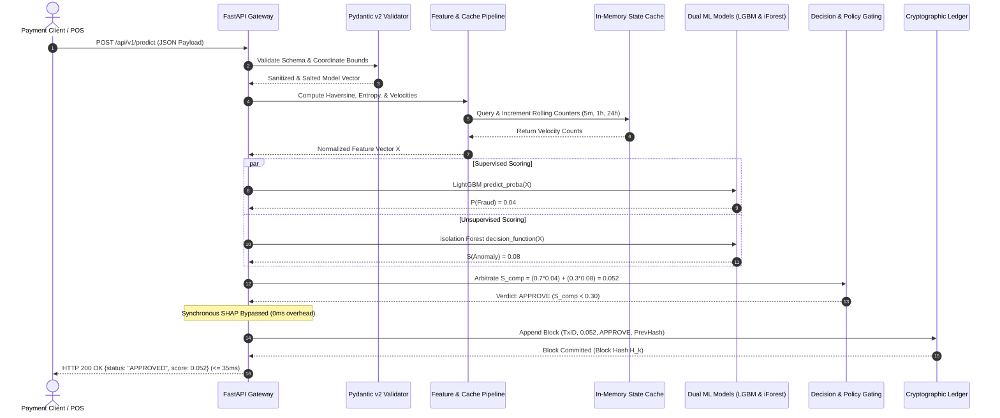
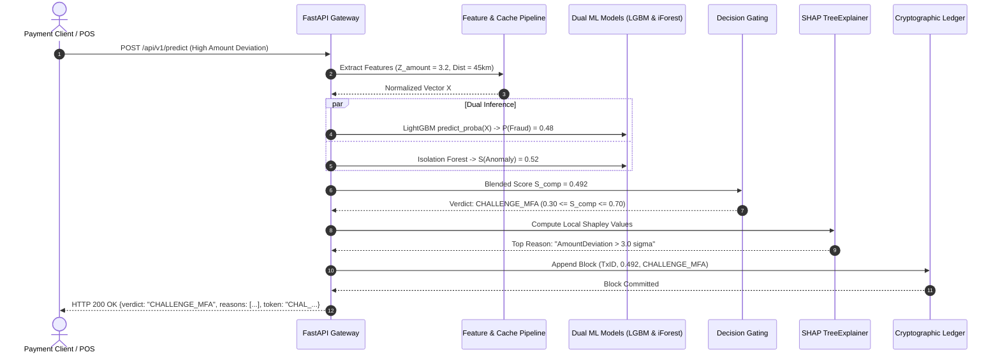
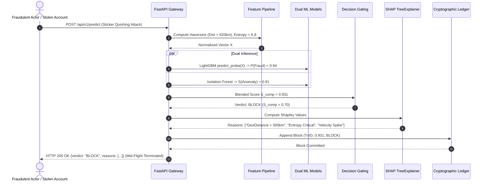
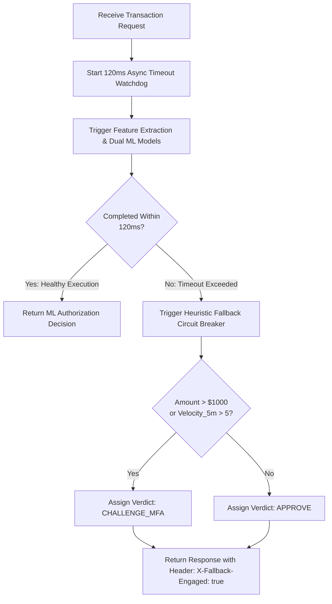
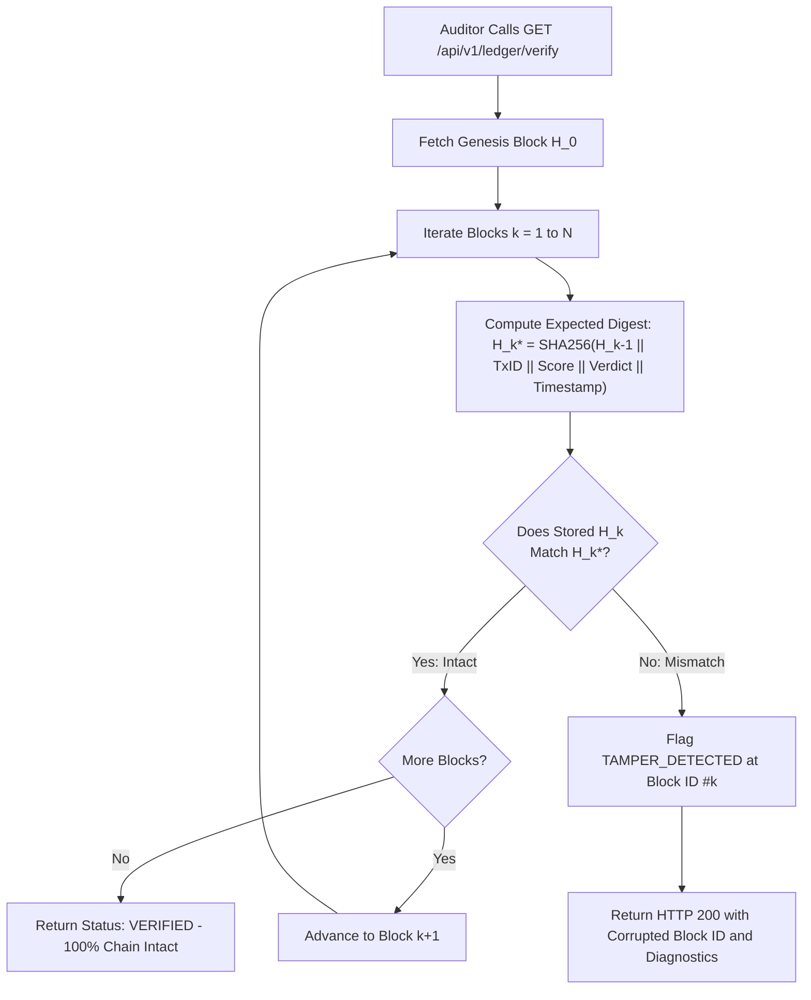
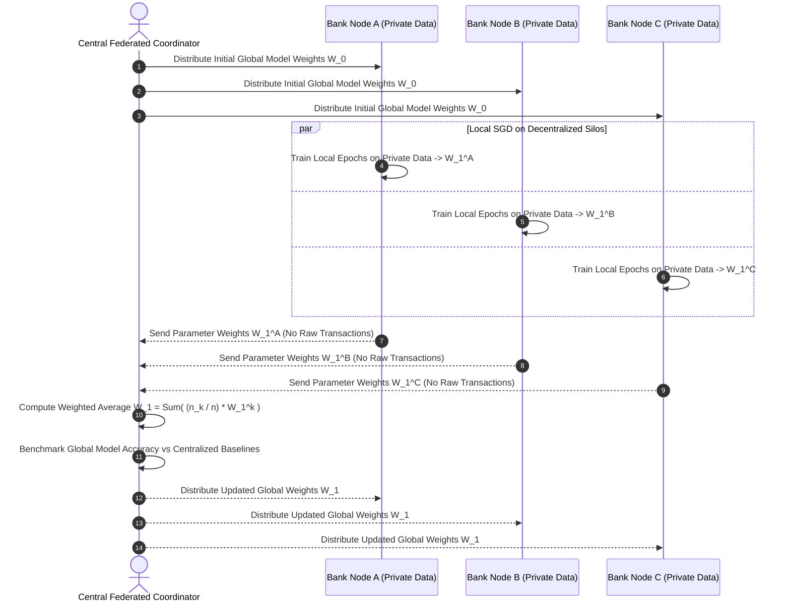

# System Workflows & Behavioral Process Engineering

**Project:** Advanced Quick Response (QR) Code Payment Fraud Detection System  
**Document Version:** 1.0.0  
**Status:** Approved for Baseline (Phase 05)  
**Parent Document:** `docs/05_System_Design/HIGH_LEVEL_DESIGN.md`  
**Reference Document:** `docs/02_Requirements/USE_CASES.md`

---

## Workflow 1: Real-Time Payment Ingestion & Low-Risk Approval



---

## Workflow 2: Suspicious Transaction & Secondary MFA Challenge



---

## Workflow 3: Critical Fraud Threat Interception & Block



---

## Workflow 4: Zero-Day Anomaly Escalation Override

```mermaid
flowchart TD
    Inference[Execute Supervised & Unsupervised Models] --> EvalScores[P_supervised = 0.35, S_anomaly = 0.86]
    EvalScores --> CheckEscalation{Is P_sup in [0.25, 0.45]\nand S_anomaly > 0.80?}

    CheckEscalation -->|Yes: Novel Threat Detected| OverrideAction[Override Standard Linear Gating]
    OverrideAction --> EscalateVerdict[Assign Verdict: CHALLENGE_MFA]
    EscalateVerdict --> FlagZeroDay[Add Diagnostic: ZERO_DAY_ANOMALY_ESCALATION]
    FlagZeroDay --> LogAudit[Commit to SHA-256 Ledger]
    LogAudit --> ReturnClient[Return HTTP 200 with Step-Up Requirement]

    CheckEscalation -->|No| StandardGating[Apply Standard Gating Thresholds]
```

---

## Workflow 5: Latency Watchdog & Heuristic Fallback Circuit Breaker



---

## Workflow 6: Cryptographic Chain Auditing & Tamper Identification



---

## Workflow 7: Decentralized Federated Model Aggregation (FedAvg)



