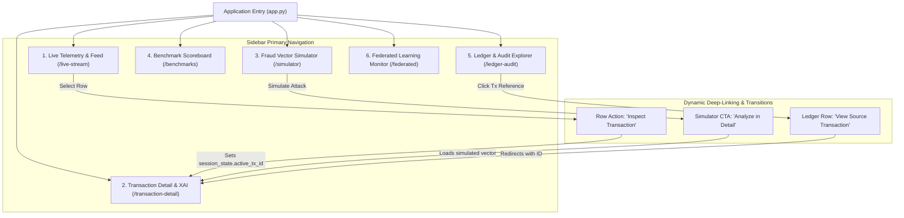

# Navigation Architecture & User Flow Specification

**Project:** Advanced Quick Response (QR) Code Payment Fraud Detection System  
**Document Version:** 1.0.0  
**Status:** Approved for Baseline (Phase 06)  
**Parent Document:** `docs/06_UI_UX/SCREEN_INVENTORY.md`  
**Framework:** Streamlit Multi-Page Navigation Structure

---

## 1. Information Architecture (IA) Model

The application adopts a flat, high-density multi-page navigation model optimized for operations centers and evaluation demonstrations:



---

## 2. Navigation State Management & Session Lifecycle

To preserve user context when navigating between screens, the UI leverages `st.session_state`:

| State Variable | Type | Default Value | Purpose |
| :--- | :--- | :--- | :--- |
| `st.session_state.active_tx_id` | String | `None` | Stores selected transaction ID for deep inspection in Screen 2. |
| `st.session_state.stream_paused` | Boolean | `False` | Toggles live polling of new transaction rows in Screen 1. |
| `st.session_state.filter_verdict` | String | `"ALL"` | Preserves active triage filter across page switches. |
| `st.session_state.sim_params` | Dictionary | `{...}` | Retains custom slider values in Screen 3 between test runs. |
| `st.session_state.audit_result` | Dictionary | `None` | Caches cryptographic chain audit report in Screen 5. |

---

## 3. Screen-to-Screen Behavioral Transitions

### 3.1 Live Stream $\longrightarrow$ Transaction Detail
1. User identifies an anomalous row (e.g., `BLOCK` verdict) on Screen 1 (`/live-stream`).
2. User clicks the `Inspect` icon button in the table row.
3. System executes:
   ```python
   st.session_state.active_tx_id = row["transaction_id"]
   st.switch_page("pages/2_Transaction_Detail.py")
   ```
4. Screen 2 initializes immediately with pre-loaded metadata, Haversine map, and SHAP Waterfall.

### 3.2 Simulator $\longrightarrow$ In-Depth XAI Analysis
1. Evaluator configures parameters on Screen 3 (`/simulator`) and clicks `Simulate Payment Transaction`.
2. Decision summary card renders inline.
3. User clicks secondary action: `Inspect Full Feature Attribution`.
4. System sets `st.session_state.simulated_tx = result` and transitions to Screen 2 to display complete force plots.

### 3.3 Ledger Audit $\longrightarrow$ Historical Transaction Lookup
1. Auditor notices a flagged block on Screen 5 (`/ledger-audit`).
2. Clicking the `tx_id` link copies the identifier to session state and opens Screen 2 in read-only audit mode.

