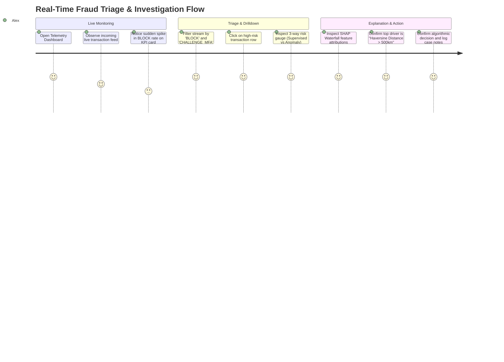
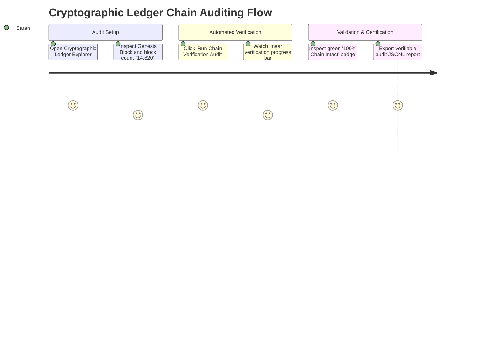
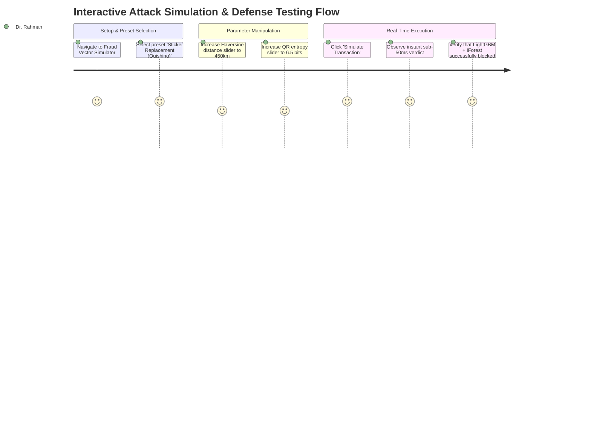

# User Journey Mapping & Persona Engineering

**Project:** Advanced Quick Response (QR) Code Payment Fraud Detection System  
**Document Version:** 1.0.0  
**Status:** Approved for Baseline (Phase 06)  
**Author:** Senior UI/UX Designer & Frontend Architect  
**Parent Document:** `docs/02_Requirements/SRS.md` | `docs/05_System_Design/HIGH_LEVEL_DESIGN.md`

---

## 1. User Personas

### Persona 1: Alex Vance — Senior Fraud Operations Analyst
- **Profile:** 34 years old, financial crimes operations team lead. Monitors high-velocity transactions across 50,000+ merchant terminals.
- **Primary Goals:**
  - Quickly identify payment anomalies without causing false-positive disruptions to legitimate shoppers.
  - Review flagged transactions mid-flight and understand the algorithmic root cause in $< 5\text{ seconds}$.
- **Key Frustrations:** "Black-box" machine learning scores that provide a raw probability number (e.g., `0.89`) with no explanation of *why* the transaction was flagged, leading to customer disputes and manual audit delays.

### Persona 2: Sarah Jenkins — Regulatory Compliance & Audit Officer
- **Profile:** 42 years old, banking oversight and legal compliance auditor.
- **Primary Goals:**
  - Verify compliance with consumer protection frameworks (GDPR Article 22, FCRA).
  - Guarantee that historical transaction decisions cannot be modified, deleted, or repudiated.
- **Key Frustrations:** Database tampering risks, lack of verifiable audit trails, and inability to prove algorithmic fairness.

### Persona 3: Prof. Dr. Rahman — Academic Supervisor & Thesis Evaluator
- **Profile:** 51 years old, Professor of Computer Science & Engineering.
- **Primary Goals:**
  - Interactively test and evaluate the system's defenses against novel QR attack vectors.
  - Validate model performance metrics (Recall $\ge 95\%$, Precision $\ge 90\%$, sub-100ms latency).
- **Key Frustrations:** Academic projects that only provide static slides or pre-computed benchmark charts with no live demonstration interface.

### Persona 4: Kamal Hossain — Point-of-Sale (POS) Merchant Operator
- **Profile:** 38 years old, retail supermarket owner utilizing static and dynamic QR terminals.
- **Primary Goals:**
  - Ensure zero checkout lane delays ($< 1\text{s}$ total scan-to-receipt).
  - Protection against counterfeit static QR stickers and stolen card probe attacks.
- **Key Frustrations:** False fraud rejections that embarrass regular customers and slow down the checkout queue.

---

## 2. Granular User Journey Maps

### Journey 1: Real-Time Fraud Triage & Live Stream Monitoring (Alex - Analyst)

| Journey Phase | User Action | System Touchpoint | Emotional State | System Response & Feedback |
| :--- | :--- | :--- | :---: | :--- |
| **1. Inception** | Accesses the dashboard at start of operational shift. | Navigation drawer $\rightarrow$ `Live Telemetry` (`/live-stream`). | Focused | Auto-refreshes KPI cards showing throughput ($340\text{ req/s}$), p95 latency ($58\text{ ms}$), and block rate ($1.2\%$). |
| **2. Detection** | Observes a crimson badge `BLOCK` appear at the top of the transaction feed. | Live Transaction Stream Table. | Alert | Displays pulsing status pill: `BLOCK | Risk: 0.931 | Tx: 9b1deb4d`. |
| **3. Inspection** | Clicks the transaction row to investigate root cause. | Deep link $\rightarrow$ `Transaction Detail` (`/transaction-detail?id=...`). | Analytical | Renders 3-column layout: metadata card, GPS spatial displacement map, and dual-model score breakdown. |
| **4. Explanation** | Reviews the SHAP Waterfall visualization. | SHAP Visualizer component. | Confident | Graph highlights `haversine_distance_km (+0.42)` and `qr_payload_entropy (+0.28)` as primary drivers. |
| **5. Resolution** | Copies cryptographic block hash for audit file; confirms transaction block. | Action bar: `Copy Ledger Hash`. | Satisfied | Toast notification: `Block Hash copied to clipboard. State verified.` |

---

### Journey 2: Cryptographic Ledger Chain Integrity Audit (Sarah - Auditor)

| Journey Phase | User Action | System Touchpoint | Emotional State | System Response & Feedback |
| :--- | :--- | :--- | :---: | :--- |
| **1. Access** | Navigates to the audit section for quarterly compliance check. | Navigation drawer $\rightarrow$ `Ledger & Audit` (`/ledger-audit`). | Formal / Thorough | Displays block table with parent hash links ($H_{k-1} \to H_k$) and Genesis seed. |
| **2. Verification** | Clicks primary CTA: `Run Chain Verification Audit`. | Action button: `Run Audit`. | Expectant | Calls `GET /api/v1/ledger/verify`. Real-time progress bar recalculates SHA-256 digests over 14,000+ blocks. |
| **3. Confirmation** | Reviews audit results banner. | Verification summary card. | Reassured | Renders large green badge: `VERIFIED: 100% Chain Integrity Intact. Zero Tamper Events Detected.` |
| **4. Export** | Clicks `Export Cryptographic Audit Package`. | Export button. | Confident | Downloads standardized JSONL package containing block headers and state signatures. |

---

### Journey 3: Interactive Attack Simulation & Thesis Evaluation (Dr. Rahman - Evaluator)

| Journey Phase | User Action | System Touchpoint | Emotional State | System Response & Feedback |
| :--- | :--- | :--- | :---: | :--- |
| **1. Navigation** | Selects the interactive testing tool to verify thesis claims. | Navigation drawer $\rightarrow$ `Vector Simulator` (`/simulator`). | Curious / Skeptical | Loads preset selector: Quishing, Dynamic MITM, Velocity Micro-Probing, Normal Baseline. |
| **2. Configuration** | Selects `Sticker Replacement (Quishing)` preset. | Preset dropdown menu. | Engaged | Sliders auto-populate: Distance $= 450\text{ km}$, Scan Latency $= 800\text{ ms}$, Entropy $= 6.5$, Amount $= \$420$. |
| **3. Execution** | Clicks `Simulate Transaction`. | Action button: `Run Inference`. | Critical | Submits JSON to `/api/v1/predict`. Timer measures round-trip latency ($38.2\text{ ms}$). |
| **4. Verification** | Observes immediate response panel. | Response card & SHAP Waterfall. | Impressed | Displays `BLOCK | Risk: 0.942`. Live SHAP Waterfall highlights geo-distance and entropy as dominant causes. |
| **5. Validation** | Navigates to `Model Benchmarks` to inspect comparative ROC/PR curves. | Navigation drawer $\rightarrow$ `Benchmarks` (`/benchmarks`). | Convinced | Inspects scoreboard confirming LightGBM recall $\ge 97.5\%$ and PR-AUC $\ge 0.91$. |

