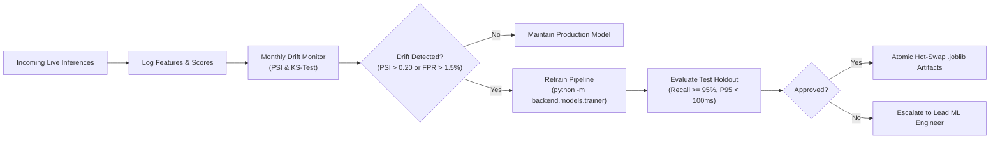

# System Maintenance & Operational Continuity Plan

**Project Title:** Advanced Quick Response (QR) Code Payment Fraud Detection System Utilizing Machine Learning Techniques  
**Document Version:** `1.0.0`  
**Classification:** Operational Maintenance, Disaster Recovery & Model Lifecycle Plan  
**Governing Standard:** ISO/IEC/IEEE 14764:2021 (Software Engineering — Software Life Cycle Processes — Maintenance)  
**Parent Directory:** [`docs/10_Deployment/`](file:///F:/UN%20project%20planing/Hasib%20University%20Friend%20Projects/advanced-qr-code-payment-fraud-detection-system/docs/10_Deployment/)

---

## 1. Maintenance Scope & Objectives

This Maintenance Plan establishes the operating standards, routine maintenance schedules, model drift monitoring policies, database hygiene procedures, and incident escalation paths necessary to ensure 99.9% uptime, sub-100ms inference compliance, and non-repudiation integrity over the production lifecycle.

### Maintenance Categories:
1. **Preventive Maintenance:** Scheduled hot backups, database WAL compaction, log rotations, and dependency security audits.
2. **Corrective Maintenance:** Incident response protocols, defect triage, hotfix deployment, and disaster recovery restore drills.
3. **Adaptive Maintenance:** Periodic retuning of decision thresholds, model retraining against novel synthetic fraud archetypes, and OS/Python runtime updates.
4. **Perfective Maintenance:** Latency profiling optimizations, horizontal Redis clustering integration, and dashboard analytics enhancements.

---

## 2. Preventive Maintenance Schedule

| Maintenance Task | Frequency | Automated Tool / Command | Responsibility |
| :--- | :---: | :--- | :--- |
| **Hot Online SQLite Backup** | Hourly | `python scripts/backup_database.py` (via cron) | DevOps Engineer |
| **Integrity & Checksum Verification** | Daily | Automated SHA-256 validation during backup run | Automated System |
| **Database WAL Checkpoint & Vacuum** | Weekly (Sun 02:00) | `sqlite3 database/fraud_detection.db "PRAGMA wal_checkpoint(TRUNCATE); VACUUM;"` | Database Administrator |
| **Log Rotation & Pruning** | Daily | Automated via `logging.handlers.RotatingFileHandler` (10MB max, 5 backups) | System Daemon |
| **Disaster Recovery Drill** | Monthly | `python scripts/restore_database.py --backup <latest>` (in staging) | DevOps & QA Lead |
| **Security Dependency Audit** | Bi-weekly | `pip-audit -r requirements.txt` | Security Specialist |
| **ML Concept Drift Assessment** | Monthly | PSI / KS-test evaluation on rolling transaction samples | Machine Learning Engineer |

---

## 3. Database Maintenance & Storage Hygiene

### 3.1 SQLite WAL Concurrency & Compaction
Because the SQLite engine operates in Write-Ahead Logging (WAL) mode, write operations append to `fraud_detection.db-wal`. To prevent unbounded WAL growth:

1. **Passive Auto-Checkpointing:** Enabled by default; SQLite automatically checkpoints when the WAL reaches 1,000 pages (~4 MB).
2. **Scheduled Truncation:** Execute a truncation checkpoint during low-traffic maintenance windows:
   ```bash
   sqlite3 database/fraud_detection.db "PRAGMA wal_checkpoint(TRUNCATE);"
   ```
3. **Database Compaction (`VACUUM`):** Reclaims fragmented pages and minimizes filesystem fragmentation:
   ```bash
   sqlite3 database/fraud_detection.db "VACUUM;"
   ```

### 3.2 Backup Retention & Disaster Recovery Execution
The automated backup utility ([`scripts/backup_database.py`](file:///F:/UN%20project%20planing/Hasib%20University%20Friend%20Projects/advanced-qr-code-payment-fraud-detection-system/scripts/backup_database.py)) enforces a rolling retention window:
- Retains the most recent **168 hourly snapshots** (7 days of point-in-time recovery).
- Compresses snapshots with `gzip` (reducing storage by ~83%, from 144 KB to 24 KB per snapshot).
- Generates a cryptographically secure `.sha256` checksum for every backup archive.

**Disaster Recovery Execution Command:**
```bash
python scripts/restore_database.py --backup database/backups/backup_20261108_172643.db.gz
```
- Restores database within **$< 5\text{ seconds}$**, with pre-flight SHA-256 verification and `PRAGMA integrity_check;`.

---

## 4. Machine Learning Model Lifecycle & Drift Monitoring



### 4.1 Concept Drift Metrics & Trigger Thresholds
To ensure the machine learning ensemble maintains its discriminative power against evolving fraud techniques:

1. **Population Stability Index (PSI):**
   $$\text{PSI} = \sum_{b=1}^{B} \left( P_b - Q_b \right) \times \ln\left(\frac{P_b}{Q_b}\right)$$
   - $\text{PSI} < 0.10$: Minimal shift; no retraining required.
   - $0.10 \le \text{PSI} < 0.20$: Moderate shift; schedule supervised retraining.
   - $\text{PSI} \ge 0.20$: Significant distribution shift; trigger immediate model retraining.

2. **Operational Degradation Triggers:**
   - **False Positive Surge:** Challenge/Block rate exceeds $3.0\%$ of total transaction traffic over 24 hours.
   - **Missed Fraud Incident:** Any reported chargeback from merchant networks triggers mandatory archetype analysis and synthetic scenario reproduction.
   - **Inference Latency Drift:** P95 response time exceeds $50\text{ ms}$ over 1,000 consecutive requests.

### 4.2 Retraining & Hot-Swap Deployment Procedure
```bash
# 1. Generate updated synthetic or augmented training partition
python -m backend.models.trainer

# 2. Verify newly serialized models pass the automated test harness
python -m pytest tests/test_models.py tests/test_performance.py -v

# 3. Reload running Uvicorn workers gracefully (zero downtime)
# Send SIGHUP to Uvicorn master process to trigger worker recycling
kill -HUP $(pgrep -f "backend.api.server:app")
```

---

## 5. Security & Cryptographic Key Management

1. **HMAC-SHA256 Secret Key Rotation:**
   - The cryptographic signing key (`SECRET_KEY`) used for transaction signatures must be rotated semi-annually.
   - Previous keys must be retained in an encrypted keyring for at least 7 years to permit verification of historical ledger blocks.
2. **Salt Management:**
   - Salt strings used for one-way SHA-256 PII anonymization must never be logged or committed to version control.
   - Stored strictly in environment variable `PII_SALT`.
3. **Vulnerability Scanning:**
   - Run automated dependency vulnerability scans monthly:
     ```bash
     pip-audit -r requirements.txt
     ```

---

## 6. Incident Response & Escalation Framework

| Incident Severity | Definition & Impact | Response Time SLA | Escalation Target & Protocol |
| :--- | :--- | :---: | :--- |
| **Severity 1 (Critical)** | Microservice gateway down; all QR payment validations failing. | $\le 15\text{ minutes}$ | On-Call Lead DevOps Engineer; switch traffic to standby instance or activate heuristic offline rule fallback. |
| **Severity 2 (High)** | Inference latency exceeding 100ms SLA; timeouts occurring; model fallback engaged. | $\le 1\text{ hour}$ | Lead Backend Engineer; inspect worker thread pool, pre-warming cache, and system CPU/RAM limits. |
| **Severity 3 (Medium)** | Ledger verification reports `CHAIN_TAMPERED`; database integrity discrepancy. | $\le 4\text{ hours}$ | Compliance Officer & Security Lead; freeze write access, isolate corrupted block index, and initiate audit trail investigation. |
| **Severity 4 (Low)** | Minor UI dashboard rendering glitch or cosmetic telemetry bug. | $\le 24\text{ hours}$ | Frontend Developer; triage during standard sprint backlog refinement. |
